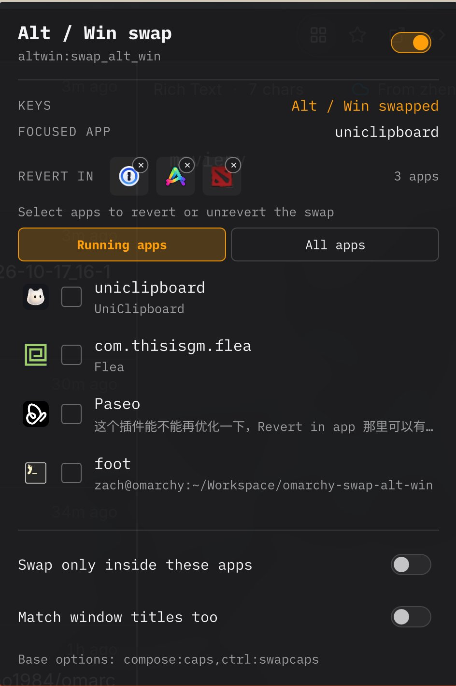

# Alt / Win 交换（Omarchy 插件）



插件 id：`omarchy-swap-alt-win`（仓库/目录同名）· IPC 目标：`swap-alt-win` ·
配置文件：`~/.config/omarchy/swap-alt-win.json`

一个 Omarchy shell 插件，用 Hyprland 的 XKB `altwin` 选项把 **Alt** 和 **Win/Super**
键对调，并且可以按**当前聚焦的应用**自动切换回来：把某个应用加入例外列表后，
聚焦它时恢复原始键位，离开后再次交换。

适合 macOS 键盘习惯（Cmd 位置）或键盘物理位置与标注不一致的情况。

- 保留你已有的 `kb_options`（例如 `compose:caps,ctrl:swapcaps`），只增删交换选项。
- 支持反向模式：只在列表里的应用内交换，其他应用保持原样。
- 服务里只有一个引擎实例；每个显示器上的状态栏图标只是它的视图。
- 插件关闭 / 禁用 / 卸载时会把你的原始键位放回去。
- 手改配置或 `hyprctl reload` 后会自动重新学习基线并重新应用。

## 环境要求

- Omarchy 4（Hyprland 0.5x，Lua 配置）。
- 写入走 `hyprctl eval`；老式（legacy）配置会自动回退到 `hyprctl keyword`。
- 不需要 root，不修改 `~/.config/hypr/input.lua`。

> **注意：** 交换是全局的。交换生效时，Omarchy 的 `SUPER` 快捷键会改由**物理
> Alt 键**触发；`Alt` 快捷键则改由物理 Win 键触发。这正是“交换键位”的含义。

## 安装

直接从 GitHub 安装（推荐）：

```bash
omarchy plugin add https://github.com/zachzhao1984/omarchy-swap-alt-win --enable --yes
```

从本地仓库安装：

```bash
# 在本仓库目录中
./install.sh                 # 安装并把键盘图标放进状态栏右侧
./install.sh --no-enable     # 只安装，不启用
./install.sh --headless      # 安装并作为无界面服务启用（不占状态栏）
```

手动安装：

```bash
mkdir -p ~/.config/omarchy/plugins
cp -r . ~/.config/omarchy/plugins/omarchy-swap-alt-win
omarchy plugin validate ~/.config/omarchy/plugins/omarchy-swap-alt-win
omarchy plugin enable omarchy-swap-alt-win --section right
```

升级 / 重新安装：再次运行 `./install.sh` 即可（不会重复启用）。

无界面模式也可以直接编辑 `~/.config/omarchy/shell.json`，在顶层 `plugins` 数组里加入：

```json
{ "id": "omarchy-swap-alt-win" }
```

## 使用

状态栏图标（键盘形）：

| 操作 | 效果 |
|------|------|
| 左键 | 打开配置面板 |
| 右键 | 打开 / 关闭插件 |
| 中键 | 重新读取 Hyprland 与当前窗口 |

图标含义：

- 亮 = 当前正在交换（物理 Alt 触发 Super）
- 暗 = 当前是原始键位：可能是插件关闭，或正处在例外应用里

面板里可以：

- 总开关
- 例外列表有两个来源，用 `Running apps` / `All apps` 切换：
  - `Running apps`：**当前打开的程序**，按聚焦顺序排列，带程序图标，
    点一下加入、再点一下移出。
  - `All apps`：**所有已安装程序**（读取 `.desktop` 条目），同样带程序图标，
    另有搜索框；选中后按 `StartupWMClass`（没有则用 desktop id）作为匹配规则。
- `REVERT IN` / `SWAP ONLY IN` 标题同一行会显示**已选应用的图标**（可横向滚动）；
  每个图标右上角有一个小 `×`，点击即可移除该应用的 revert（鼠标悬停图标可看到
  对应的 class / 规则）。`title:` 规则、手写正则和已卸载应用的规则也会以图标形式
  显示在这里。
- 切换“只在列表内交换”模式
- 打开 / 关闭标题匹配
- 查看当前基线（去除交换后的 `kb_options`）

列表里的每一行显示程序图标、程序名、匹配用的窗口 class；已加入的会打勾。
两个列表共用同一套行样式。列表较长时会在面板内滚动（约显示 4 行，搜索可快速定位）。
面板本身是键盘可聚焦的层 shell 弹层，搜索框可以直接输入，`Esc` 关闭面板。

命令行：

```bash
omarchy-shell swap-alt-win status        # JSON：状态、当前窗口、配置
omarchy-shell swap-alt-win enable
omarchy-shell swap-alt-win disable
omarchy-shell swap-alt-win toggle
omarchy-shell swap-alt-win isSwapped     # true/false
omarchy-shell swap-alt-win keyState      # swapped / normal / restore
omarchy-shell swap-alt-win addActive     # 当前窗口加入列表
omarchy-shell swap-alt-win removeActive
omarchy-shell swap-alt-win setMode revert|only
omarchy-shell swap-alt-win refresh       # 重新读取
```

### 快捷键（可选）

在 `~/.config/hypr/bindings.lua` 里可以加一个总开关：

```lua
o.bind("SUPER + SHIFT + K", "Toggle Alt / Win swap", "omarchy-shell swap-alt-win toggle")
```

交换生效时，`SUPER` 快捷键会随物理 Alt 键走，写绑定的时候留意这一点。

## 配置

首次运行会创建 `~/.config/omarchy/swap-alt-win.json`：

```json
{
  "version": 1,
  "enabled": true,
  "mode": "revert",
  "swapOption": "altwin:swap_alt_win",
  "matchTitles": false,
  "apps": ["firefox", "org.gnome.Nautilus", "title:YouTube"]
}
```

| 字段 | 说明 |
|------|------|
| `enabled` | 插件总开关。`false` 时恢复原始键位。 |
| `mode` | `revert`：默认交换，只在 `apps` 里恢复原样。<br>`only`：默认原样，只在 `apps` 里交换。 |
| `swapOption` | XKB 选项。默认 `altwin:swap_alt_win`（左右两侧都换）。也可用 `altwin:swap_lalt_lwin` / `altwin:swap_ralt_rwin` 只换一侧。 |
| `matchTitles` | `true` 时，普通规则也会匹配窗口标题。 |
| `apps` | 例外 / 目标应用列表。 |

匹配规则：

- 不区分大小写。
- 能当正则就当正则（如 `firefox|chromium`）；写不成正则时按普通子串匹配。
- 默认只匹配窗口 class（Hyprland 的 `class`）；`matchTitles: true` 时同时匹配标题。
- `title:` 前缀强制只匹配标题，例如 `title:YouTube`。

窗口 class 可以用 `hyprctl activewindow -j | jq -r .class` 查看，或在面板的
`FOCUSED APP` 一行直接看到。

文件保存后会自动生效（文件监听），也可以手动

```bash
omarchy-shell swap-alt-win refresh
```

## 工作原理

- 读取 `hyprctl -j getoption input:kb_options` 得到当前基线，剔除本插件管理的交换选项，
  得到 `plainOptions`。
- 交换状态 = `plainOptions + swapOption`；恢复状态 = 基线。
- 通过 `hyprctl eval 'hl.config({ input = { kb_options = "..." } })'` 写入。
  Hyprland 0.5x 的 `hyprctl keyword` 对 Lua 配置解析器无效；写入后插件会读回确认，
  不匹配时再尝试 legacy 的 `keyword` 路径。
- 监听 Hyprland socket2 的 `activewindow` 事件（含 XWayland 窗口），120ms 去抖后切换。
- `Running apps` 列表来自 `hyprctl -j clients`：按 `focusHistoryID` 排序、按 class 去重，
  图标按窗口 class / 程序名在 `DesktopEntries` 里查找；
  在聚焦 / 开窗 / 关窗事件以及每次打开面板时重新读取。- `All apps` 列表来自 Quickshell 的 `DesktopEntries.applications`，按名称排序，
  图标用 `Quickshell.iconPath()` 解析；`Hidden` / `NoDisplay` 条目默认不会出现。
- 收到 `configreloaded` 时重新学习基线（你改了 `input.lua` 也能跟上），然后重新应用。
- `Service.qml` 是唯一引擎实例（shell 对已启用插件的 service 只挂载一次）；
  `BarWidget.qml` 通过 `bar.shell.serviceFor("omarchy-swap-alt-win")` 取状态并转发操作。

## 已知限制

- `kb_options` 是全局设置，所有键盘一起换。需要按设备区分时，可以在
  `~/.config/hypr/input.lua` 里给某台键盘单独设置 `kb_options`（会覆盖全局）。
- 切换瞬间如果正按着 Alt/Win/Super，可能会有一次修饰键状态抖动；松开再按即可。
- 某些游戏使用原始输入或自己的键位设置，交换对它们是否生效取决于游戏读取哪一层。
- 状态栏图标依赖 Omarchy 自带状态栏；用无界面模式则没有图标。

## 排错

```bash
hyprctl getoption input:kb_options          # 当前生效的选项
omarchy-shell swap-alt-win status              # 插件视角
journalctl --user -b | grep -i swap-alt-win    # 插件日志
```

- 图标一直是暗的：确认 `~/.config/omarchy/shell.json` 的 `bar.layout` 里有
  `{ "id": "omarchy-swap-alt-win" }`，或 `omarchy plugin list | grep omarchy-swap-alt-win`。
- 状态显示 `error`：通常是 `hyprctl` 不可用。确认在 Hyprland 会话内运行。
- `omarchy-shell swap-alt-win status` 提示 `Target not found`：插件服务还没挂载
  （常见于刚热重载完插件）。运行 `omarchy restart shell` 即可；`install.sh`
  结束前也会自动检查并提示。
- 想立刻恢复原始键位：右键图标、`omarchy-shell swap-alt-win disable`，或
  `omarchy plugin disable omarchy-swap-alt-win`。

## 卸载

```bash
omarchy plugin disable omarchy-swap-alt-win
omarchy plugin remove omarchy-swap-alt-win
rm -f ~/.config/omarchy/swap-alt-win.json
```

禁用或卸载时插件会把原始键位写回去。

## 开发

```bash
node --test tests/          # Model.js 的纯逻辑测试
```

修改 QML 后，shell 会热重载插件文件，但已加载的组件可能被缓存；可靠的做法是：

```bash
./install.sh --no-enable
omarchy restart shell
```
